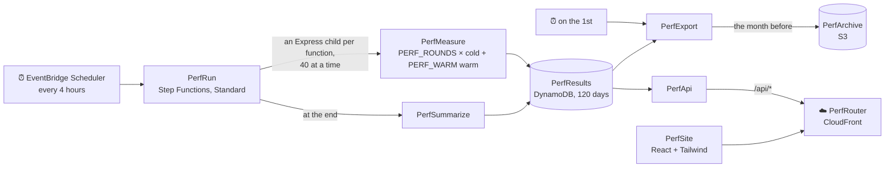

<div align="center">


# ⚡ lambda-coldstarts

**How fast do Bun, LLRT and Node.js cold-start on AWS Lambda?**<br>
130 real Lambdas, benchmarked every 4 hours.

[🌐 Live results](https://coldstarts.github.nimmervoll.work) ·
[🚀 Deploy](#-deploy) ·
[⏱️ Benchmark](#%EF%B8%8F-benchmark) ·
[🕐 Scheduled runs](#-scheduled-runs) ·
[🛠️ Develop](#%EF%B8%8F-develop)

[](.github/workflows/ci.yml)
[](.github/workflows/deploy.yml)

</div>

## 🤔 What's in the box

One SST stack. Every function runs the same handler ([`src/report.ts`](src/report.ts)) and gets a
public Function URL, on **x86_64 and arm64** at **128, 256, 512, 1024 and 1769 MB**:
13 variants × 2 architectures × 5 sizes = **130 functions**, named like `BunCompileArm64M128`.

|     | Variant                        | What ships                                                                           |
| --- | ------------------------------ | ------------------------------------------------------------------------------------ |
| 🥟  | `BunRuntime`                   | `bun` executable + bundled `index.js`, started by a shell `bootstrap`                |
| 🥟  | `BunCompile`                   | `bun build --compile --minify --bytecode` executable as `bootstrap`                  |
| 🥟  | `BunCompileCanary`             | the same, built by Bun canary: the baseline for `--trim` and `--aot`                 |
| 🥟  | `BunCompileTrim`               | `BunCompileCanary` + `--trim`, which drops the parts of Bun the code doesn't use     |
| 🥟  | `BunCompileAot`                | `--compile --aot`, behind a `bootstrap` that preloads the [AOT shim](#-the-aot-shim) |
| 🥟  | `BunCompileAotTrim`            | `--aot --trim`                                                                       |
| 🪶  | `Llrt`                         | [LLRT](https://github.com/awslabs/llrt)'s no-sdk Lambda build + bundled `index.mjs`  |
| 🪶  | `LlrtBytecode`                 | the bundle as `llrt compile` bytecode, run by LLRT's CLI build                       |
| 🪶  | `LlrtStdSdk`                   | `Llrt` on LLRT's default Lambda build, with the common AWS SDK clients built in      |
| 🪶  | `LlrtFullSdk`                  | `Llrt` on LLRT's full-sdk Lambda build, with every AWS SDK client built in           |
| 🟢  | `Node22` · `Node24` · `Node26` | SST's esbuild bundle on `nodejs22.x`, `nodejs24.x`, `nodejs26.x` (preview)           |
| 🌐  | `Node24Web`                    | a `node:http` server on a [Lambda Web Function](#-the-web-function)                  |
| 📦  | `Node24MicroVm`                | the same server in a [Lambda MicroVM](#-the-microvm), resumed from a snapshot        |

Everything runs in **eu-central-1**, `Node24Web` and `Node24MicroVm` included.

Bun and LLRT run on `provided.al2023`. Bun serves invocations through a small runtime loop
([`src/runtime.ts`](src/runtime.ts)), LLRT through its own ([`src/llrt.ts`](src/llrt.ts)), and Node
through Lambda's managed runtime.

## 🚀 Deploy

```sh
bun install
cp .env.example .env         # add AWS_PROFILE or access keys
bun run deploy --stage dev   # builds both architectures in Docker, deploys all 130 functions
bun run remove --stage dev   # tears it down again (production is retained)
```

- 🔁 `bun run just-deploy` deploys the bundles already in `dist/` without building them again.
- 🎯 `bun run build --arch arm64 BunCompileAot` builds only the variants you name, into `dist/<arch>/<Variant>`.
- 🐳 Builds run in Amazon Linux 2023 containers, Lambda's own OS, with Bun 1.4.4 and the latest
  canary ([`infra/build-image.sh`](infra/build-image.sh)). The image is cached until that script
  changes; `docker rmi $(docker images -q lambda-coldstarts-build)` picks up a newer canary.
- 🦾 The architecture your host doesn't have builds under QEMU. On Docker Engine (Linux, WSL), register
  it once per boot: `docker run --privileged --rm tonistiigi/binfmt --install arm64`
- ⚠️ A plain `bunx sst deploy` builds on the host, for its architecture only, and replaces the
  other architecture's functions.

| Variable        | Default                 | What it does                                                   |
| --------------- | ----------------------- | -------------------------------------------------------------- |
| `LAMBDA_ARCH`   | the host's              | `x86_64`, `arm64` or `x86_64,arm64`                            |
| `LAMBDA_MEMORY` | `128,256,512,1024,1769` | Memory sizes in MB; one function per variant and size          |
| `VARIANTS`      | all                     | e.g. `BunCompile,Node24`                                       |
| `BUN_BIN`       | `bun`                   | Bun for `BunRuntime` and `BunCompile`                          |
| `BUN_AOT_BIN`   | `$BUN_BIN`              | Bun for `BunCompileCanary`, `--trim` and `--aot`               |
| `CC`            | `cc`                    | C compiler for the AOT shim                                    |
| `BUN_BUNDLES`   | unset                   | Deploy Bun/LLRT from `$BUN_BUNDLES/<arch>/<Variant>`, no build |

## 🧪 `--aot` and `--trim`

Both landed in [oven-sh/bun#45631](https://github.com/oven-sh/bun/pull/45631), after 1.4.4, so for
now only [canary builds](https://github.com/oven-sh/bun/releases/tag/canary) have them.

- 🙈 Released Bun **silently accepts unknown flags**, so the build checks `bun build --help` and
  skips a variant with `Skipping <Variant>: …` instead of deploying a mislabelled plain executable.
- 🐧 `--aot` can't cross-compile: it needs **Linux on the Lambda architecture**. On a Mac, use
  `bun run build` (Docker) or the [Deploy and benchmark](.github/workflows/bench.yml) workflow.
- 📏 Compare against `BunCompileCanary`, not `BunCompile`: canary executables are ~30% larger on
  their own.
- 🔍 `bun run explain [--arch arm64] [report]` lists the handler code `--aot` compiled to slow
  paths, worst first (reports: `json`, `guards`, `guards-json`, `trim`, `missed-optimizations`,
  `allocations`).

<details>
<summary>📦 Installing the canary next to your normal Bun</summary>

The canary's files are replaced on every push to `main`, so there's no version to pin. This
checks the zip against the digest GitHub reports (use `bun-linux-aarch64` on arm64,
`bun-darwin-aarch64` on a Mac):

```sh
mkdir -p ~/.bun-aot && cd ~/.bun-aot
curl -fsSLO https://github.com/oven-sh/bun/releases/download/canary/bun-linux-x64.zip
curl -fsSL https://api.github.com/repos/oven-sh/bun/releases/tags/canary |
  jq -r '.assets[] | select(.name == "bun-linux-x64.zip") | .digest | ltrimstr("sha256:") + "  bun-linux-x64.zip"' |
  sha256sum -c
unzip -o bun-linux-x64.zip
~/.bun-aot/bun-linux-x64/bun --revision   # 1.4.4-canary.1+<commit>

BUN_AOT_BIN=~/.bun-aot/bun-linux-x64/bun bunx sst deploy --stage dev
```

A 404 or a failed checksum means a push is replacing the files; try again in a few minutes.

</details>

### 🩹 The AOT shim

[`infra/aot-shim.c`](infra/aot-shim.c) is `LD_PRELOAD`ed by the AOT `bootstrap` and works around
two things Lambda breaks. Both fixes belong upstream.

<details>
<summary>Why it's needed</summary>

1. **`mincore` → `EPERM`.** AOT executables check that page 0 is unmapped by calling `mincore()` and
   expecting `ENOMEM`. Lambda's seccomp filter returns `EPERM`, so the loader exits during init. The
   shim rewrites `EPERM` to `ENOMEM` below `mmap_min_addr`.
2. **A 256 MB `mmap` at 128 MB.** The AOT runtime maps a 256 MB table without `MAP_NORESERVE` and
   calls `abort()` when that fails, which it does in a 128 MB microVM. The shim adds
   `MAP_NORESERVE` to private, writable, anonymous mappings of 128 MB or more.

It only needs glibc 2.2.5 symbols, so it loads on Lambda's glibc 2.34.

</details>

## ⏱️ Benchmark

```sh
bun run bench                                                # 3 rounds × 10 cold, then 20 warm per function
bun run bench --rounds 5 --cold 20 --only BunCompile,Node24
```

Each round changes an environment variable on every function, which retires its warm environments,
then fires concurrent cold invocations. The numbers come from Lambda's own `REPORT` line:

- ❄️ **Init**: `Init Duration`, from runtime start until it first asks for an event
- 🏁 **In-process startup**: `performance.now()` when the handler module is evaluated
- 🔁 **Invoke / round trip**: Lambda's `Duration`, and what the client saw

Results land in `bench-results/` as Markdown and JSON. `bench` measures functions only; the Web
Function and the MicroVM are measured by the scheduled runs.

### 🌐 The Web Function

[Lambda Web Functions](https://docs.aws.amazon.com/lambda/latest/dg/web-functions.html) run an
HTTP server rather than a handler, and serve many requests per environment.
[`infra/web-function.ts`](infra/web-function.ts) deploys `Node24Web` with `aws-native`, since SST
has no component for them yet. Their API differs, and so does how it's measured
([`src/perf/web.ts`](src/perf/web.ts)):

- 🪣 **The code** sits in a versioned bucket, which Lambda reads on behalf of the function's
  revisions.
- 📏 **2 GB and 2 vCPUs on arm64**, the one size every environment gets. The site gives it a
  section of its own, against `Node24` on arm64 at whichever memory size you pick.
- 🔄 **A cold start** is a new revision that differs in `BENCH_NONCE`, which the endpoint is then
  pointed at. For a second or two after the endpoint says it's updated, requests still reach the old
  revision's environment, so the round keeps asking until a server answers its first request.
- 🔏 **The endpoint takes signed requests only** (`IamAuth`), from PerfMeasure, and is capped at
  2 environments.
- 📜 **No REPORT line**: init, duration and memory come from the environment's `platform.initReport`
  and `platform.requestComplete` events, read from its log stream (named by the
  `lambda-web-logstream` response header) in the `.local` log group.

### 📦 The MicroVM

[Lambda MicroVMs](https://docs.aws.amazon.com/lambda/latest/dg/lambda-microvms-guide.html) are
Firecracker VMs for running untrusted code, one per user, session or job. Lambda builds an image
from a Dockerfile, starts the program and snapshots it running; every MicroVM resumes from that
snapshot. [`infra/microvm.ts`](infra/microvm.ts) builds `Node24MicroVm` from
[`src/microvm.ts`](src/microvm.ts) on Lambda's `nodejs:24` container image with `aws-native`, and
[`src/perf/microvm.ts`](src/perf/microvm.ts) measures it:

- 🧊 **No init to measure.** Node started once, when the image was built, so there's nothing to
  compare with an Init Duration, and Lambda reports no durations, platform events or metrics.
- ⏱️ **First answer instead**: each round runs a new MicroVM and times, from PerfMeasure, calling
  RunMicrovm, getting an auth token and its first response. The endpoint holds that request until
  the MicroVM is running. `firstRequestMs` is the last part alone. The site sets it against an Event
  Function's cold invoke round trip (`roundTripMs`, which every round now records), from the same
  PerfMeasure.
- 🐢 **No warm round trips.** At 128 MB, PerfMeasure gets CPU in 20 ms slices, and a warm request
  of ~5 ms comes back as 20, 40 or 60. The cold ones barely move: a MicroVM's first answer took
  1.34–1.36 s from a 1769 MB PerfMeasure and 1.32–1.43 s from the 128 MB one.
- 📏 **Every size Lambda offers, on arm64**: baselines of 0.5, 1, 2, 4 and 8 GB with a vCPU per 2 GB,
  each bursting to four times both, as `Node24MicroVmM512` to `Node24MicroVmM8192`. The memory is
  the image's, so each size is an image of its own. Lambda builds a snapshot for Graviton3 and one
  for Graviton4 and picks either per MicroVM; `graviton` says which.
- 🧮 **One size at a time**, after the functions: an account may run 8 GB of MicroVMs at once
  unless the quota is raised, all of it the largest size's. A round that finds the quota taken, by
  another stage's MicroVM say, waits up to 90 s before it starts its clock.
- 🧹 **Every MicroVM is terminated** at the end of its round, and lives 2 minutes at most should
  that fail. A round costs a few seconds of compute and up to ~0.6 GB of snapshot reads: about a
  tenth of a cent at us-east-1's prices.
- 📌 **The base image is pinned** (`al2023-1` version 2). Lambda stops running a version 90 days
  after the next one comes out; `ListManagedMicrovmImageVersions` lists them.

## 🕐 Scheduled runs

In production the stack also benchmarks itself every 4 hours, the way
[maxday/lambda-perf](https://github.com/maxday/lambda-perf) does. DynamoDB keeps each run for 120
days; on the 1st, the month before goes to S3 for good.



| Piece           | Source                                           | Job                                                                     |
| --------------- | ------------------------------------------------ | ----------------------------------------------------------------------- |
| `PerfMeasure`   | [`src/perf/measure.ts`](src/perf/measure.ts)     | One round: retire warm environments, one cold invoke, then warm invokes |
| `PerfSummarize` | [`src/perf/summarize.ts`](src/perf/summarize.ts) | Per-function p50/p90/avg/min/max, stored with the run                   |
| `PerfExport`    | [`src/perf/export.ts`](src/perf/export.ts)       | A month of runs and samples, as gzipped NDJSON in `PerfArchive`         |
| `PerfApi`       | [`src/perf/api.ts`](src/perf/api.ts)             | `GET /runs/history`: the latest 90 runs, the one request the site makes |
| `PerfSite`      | [`web/`](web/)                                   | The charts at [coldstarts.github.nimmervoll.work][site]                 |

- 🧒 Each function's rounds run as an **Express child workflow**, which bills by duration instead of
  by state transition. A child gets 5 minutes; one that runs out loses its remaining rounds, like
  one whose rounds keep failing, and the run goes on without it.
- 🗄️ Every item of a run expires 120 days after the run started (`expiresAt`, DynamoDB's TTL). The
  archive holds `<yyyy>/<mm>/runs.ndjson.gz`, each run with its per-function statistics, and
  `<yyyy>/<mm>/samples.ndjson.gz`, every cold start. A run belongs to the month it started in.
- 🧪 Other stages live at `<stage>.coldstarts.github.nimmervoll.work`, tell search engines to stay
  away and run only when asked: their schedules are created paused, and a deploy pauses them again.

```sh
bun run perf --stage dev [--detach]                    # start a run now (and wait for it)
bun scripts/perf-summarize.ts --stage production [--all]   # summarize runs that have no summary yet
bun scripts/perf-export.ts --stage production --month 2026-10   # export a month again, or --all past months
bun scripts/perf-expire.ts --stage production              # let items from before the TTL expire too
```

Items written before the TTL existed have no `expiresAt` and stay until `perf-expire` gives them
one. It only does that for months the archive holds, plus the current one, which the export picks
up on the 1st. Run `perf-export --all` first.

| Variable                | Default |                                                                                                   |
| ----------------------- | ------- | ------------------------------------------------------------------------------------------------- |
| `PERF_ROUNDS`           | `10`    | Cold starts per function and run                                                                  |
| `PERF_WARM`             | `5`     | Warm invocations after each cold start                                                            |
| `PERF_ADMIN_SECRET`     | unset   | Turns on the admin routes (URL-safe characters only)                                              |
| `POSTHOG_PROJECT_TOKEN` | unset   | Turns on the site's PostHog analytics in production, sent through `/ingest` to PostHog's EU cloud |

<details>
<summary>🔐 Admin routes</summary>

With `PERF_ADMIN_SECRET` set, PerfApi takes `POST /api/admin/$PERF_ADMIN_SECRET/<action>`.
Without it, these paths 404. The unlinked `/admin` page ([`web/admin.html`](web/admin.html)) has a
button for each. PerfApi only answers through PerfRouter, whose Origin Access Control needs the
body's hash on a POST: `curl` one with
`-H 'x-amz-content-sha256: e3b0c44298fc1c149afbf4c8996fb92427ae41e4649b934ca495991b7852b855'`.

| Action   | Does                                                                                |
| -------- | ----------------------------------------------------------------------------------- |
| `run`    | Starts a run                                                                        |
| `pause`  | Stops the scheduled runs; in production, a deploy that updates the schedule resumes |
| `resume` | Starts the scheduled runs again; outside production, until the next deploy          |
| `purge`  | Empties PerfResults, ~15 s at a time; call it again until it answers `"done": true` |

</details>

## 🤖 CI/CD

- ✅ **Pull requests** run [CI](.github/workflows/ci.yml): the checks plus native x86_64 and arm64 builds.
- 🚢 **Pushes to `main`** run [Deploy](.github/workflows/deploy.yml): the same, then
  `sst deploy --stage production`.
- 📊 **[Deploy and benchmark](.github/workflows/bench.yml)** (manual) builds on native runners, deploys
  every function and benchmarks them.
- 🔑 AWS access goes through GitHub OIDC. `bun run bootstrap:aws` sets up the provider, the role and
  the `bench` and `production` environments, and is safe to re-run
  ([`scripts/bootstrap-aws.ts`](scripts/bootstrap-aws.ts)).

## 🛠️ Develop

```sh
bun run build:local   # build Bun + LLRT for this host and smoke-test every bootstrap against a fake Runtime API
bun run typecheck     # the same checks CI runs ↓
bun lint --max-warnings 0
bun fmt --check
bun test
```

`bun lint` needs a Bun canary, and the types need `bunx sst install` once.

- 🖥️ **Site against a deployed API:**
  `cd web && PERF_API_URL="$(jq -r '.perf.api' ../.sst/outputs.json)" bun run dev`
- 🖼️ **Social preview:** after editing [`web/og.html`](web/og.html), run `cd web && bun run og`
  (headless Chrome; set `CHROME` to use another binary).

## 📝 Good to know

- 📦 Compiled Bun executables are ~100 MB against a few KB for Node. Lambda fetches them on every cold
  start, which shows up in the round trip even when init is fast.
- 🪶 LLRT is pinned in [`infra/llrt.ts`](infra/llrt.ts). `Llrt` and `LlrtBytecode` use the no-sdk
  builds; `LlrtStdSdk` (6.2 MB) and `LlrtFullSdk` (7.7 MB) run the same handler, which imports no
  SDK client, so against `Llrt` (5.2 MB) they show what the embedded SDK costs on its own. LLRT's
  TLS warm-up only connects for imported clients, so it isn't part of it.
  [`src/llrt-env.ts`](src/llrt-env.ts) fills in the `process` and `navigator` APIs it lacks.
- 🧩 `LlrtBytecode` ships LLRT's CLI build (14 MB vs 5.5 MB), because only the CLI build reads
  bytecode the CLI compiled. Comparing it with `Llrt` therefore compares the executables as well.
  Like `--aot`, it only builds on Linux on the Lambda architecture.
- 📌 `nodejs26.x` needs the AWS provider pinned to 7.52.0 in [`sst.config.ts`](sst.config.ts).
- 🚫 Every function sets `dev: false`, since `sst dev` would route it to your machine.

[site]: https://coldstarts.github.nimmervoll.work
